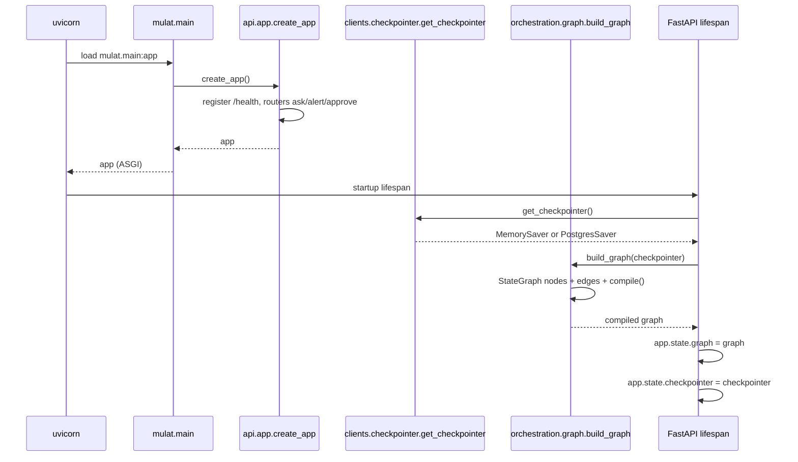
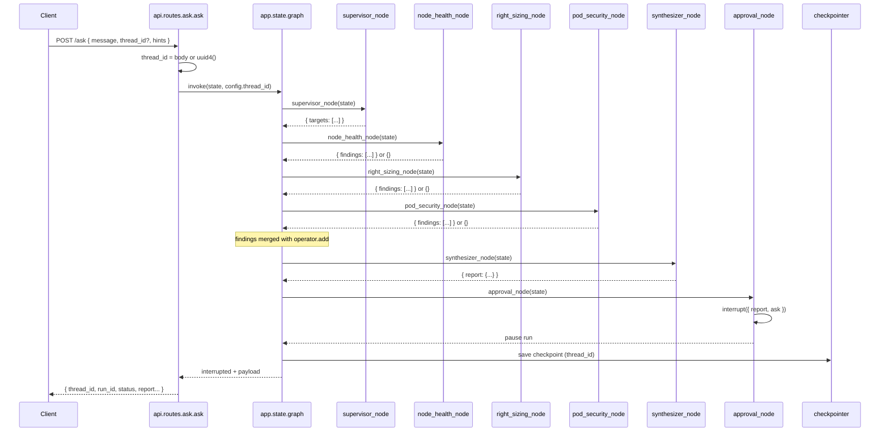
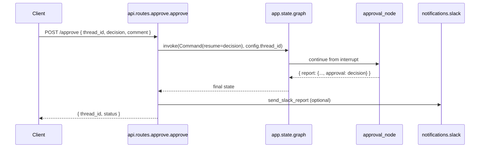

# Call flow — mulat (from `main.py`)

This document traces execution from process startup through FastAPI routes into the LangGraph orchestration layer. It matches the scaffold under `src/mulat/` and the architecture in [k8s-multi-agent-troubleshooter.md](./k8s-multi-agent-troubleshooter.md).

**Legend:** Steps marked **TODO** are designed but not fully wired in code yet.

---

## Layers

| Layer | Package | Role |
| --- | --- | --- |
| Entry | `mulat.main` | ASGI app for Uvicorn |
| API | `mulat.api` | HTTP: `/health`, `/ask`, `/alert`, `/approve` |
| Orchestration | `mulat.orchestration` | LangGraph: supervisor → agents → synthesizer → approval |
| Tools | `mulat.tools` | Read-only `@tool` functions (see [Tool_API.md](./Tool_API.md)) |
| Clients | `mulat.clients` | Kubernetes, Prometheus, LLM, checkpointer |

---

## Phase A — Process startup

Triggered when Uvicorn loads `mulat.main:app` (or `python -m mulat.main` via `cli()`).



**Call chain:**

```text
uvicorn mulat.main:app
  └─ import mulat.main
       └─ app = create_app()                    # mulat/api/app.py
            └─ (on startup) lifespan()
                 ├─ get_checkpointer()          # mulat/clients/checkpointer.py
                 └─ build_graph(checkpointer)  # mulat/orchestration/graph.py
                      └─ graph.compile(...)     → app.state.graph
```

**Configuration:** `mulat.config.settings` loads `.env` (host, port, `PROMETHEUS_URL`, `DATABASE_URL`, LLM keys, timeouts).

---

## Phase B — `POST /ask` (investigation)

**Current behavior:** `api/routes/ask.py` allocates `thread_id` / `run_id` and returns `accepted` with a stub message. **`graph.invoke` is TODO.**

**Target behavior:**



**Initial graph state** (input from `/ask`):

```python
{
    "request": body.message,
    "source": body.source,
    "hints": body.hints,
}
```

**Invoke config** (same `thread_id` for resume):

```python
config = {"configurable": {"thread_id": thread_id}}
```

---

## Phase C — Inside the graph (node order)

Compiled in `orchestration/graph.py`. Today agents run **sequentially**; architecture doc calls for **parallel `Send()`** from the supervisor (TODO).

```text
graph.invoke(initial_state, config)
  │
  ├─ START
  ├─ supervisor_node          # orchestration/supervisor.py → sets targets
  ├─ node_health_node         # orchestration/agents/node_health.py
  ├─ right_sizing_node        # orchestration/agents/right_sizing.py
  ├─ pod_security_node        # orchestration/agents/pod_security.py
  ├─ synthesizer_node         # orchestration/synthesizer.py → report
  ├─ approval_node            # orchestration/approval.py → interrupt()
  └─ END                      # after human resume only
```

**Shared state** (`orchestration/state.py`):

| Field | Set by | Notes |
| --- | --- | --- |
| `request`, `source`, `hints` | API / alert route | User or alert text |
| `targets` | Supervisor | Which agents to run |
| `findings` | Agent nodes | Appended via `operator.add` reducer |
| `report` | Synthesizer | Merged report for humans |

**Agent → tools → clients** (when implemented):

```text
node_health_node
  └─ ReAct agent + node_health_tools   # tools/registry.py
       └─ list_nodes, describe_node, …  # tools/node_health/*
            └─ clients/kubernetes.py

right_sizing_node
  └─ sizing_tools
       └─ query_cpu_usage, …           # tools/right_sizing/*
            └─ clients/prometheus.py

pod_security_node
  └─ security_tools
       └─ check_security_context, …     # tools/pod_security/*
            └─ clients/kubernetes.py (+ rule engines)
```

System prompts live in `prompts/*.md` and are loaded when building ReAct agents.

---

## Phase D — `POST /approve` (resume)

After `approval_node` calls `interrupt()`, the run is paused. A human (or Postman) sends a decision.



**Planned call (TODO in `approve.py`):**

```text
approve()
  └─ graph.invoke(
         Command(resume={"decision": "approve"|"reject", "comment": ...}),
         config={"configurable": {"thread_id": body.thread_id}},
     )
       └─ approval_node completes
       └─ END
```

Requires the same **checkpointer** and **thread_id** as the original `/ask` run.

---

## Phase E — `POST /alert`

Alertmanager webhook → normalize alert labels/annotations into a investigation message → **same graph entry as `/ask`** (`api/routes/alert.py`). Flow after `invoke` is identical to Phase B and C.

---

## End-to-end map

```text
main.py
  app = create_app()
       │
       ├─ [startup] get_checkpointer() → build_graph() → app.state.graph
       │
       ├─ POST /ask  ──► ask.py ──► graph.invoke(...)     [invoke: TODO]
       ├─ POST /alert ► alert.py ► graph.invoke(...)     [invoke: TODO]
       └─ POST /approve ► approve.py ► Command(resume)  [resume: TODO]
                │
                └─ orchestration/graph.py
                     supervisor → agents → synthesize → approval(interrupt)
                          agents → tools → clients
```

---

## Implementation status

| Step | Status |
| --- | --- |
| `main.py` → `create_app()` | Done |
| Lifespan → `build_graph()` + checkpointer on `app.state` | Done |
| `POST /ask` → `graph.invoke` | TODO |
| ReAct agents + registered tools | TODO (stub findings) |
| Supervisor parallel `Send()` | TODO (sequential edges today) |
| `POST /approve` → `Command(resume=...)` | TODO |
| Slack notification after approval | Stub in `notifications/slack.py` |

Suggested build order: see **Suggested implementation order** in [DIRECTORY_STRUCTURE.md](./DIRECTORY_STRUCTURE.md).

---

## Related documents

| Document | Contents |
| --- | --- |
| [DIRECTORY_STRUCTURE.md](./DIRECTORY_STRUCTURE.md) | Folder layout and module roles |
| [k8s-multi-agent-troubleshooter.md](./k8s-multi-agent-troubleshooter.md) | LangGraph design, deployment, agents |
| [Tool_API.md](./Tool_API.md) | Tool inputs/outputs and RBAC |
| [postman/mulat-agent-api.postman_collection.json](./postman/mulat-agent-api.postman_collection.json) | HTTP test requests |
