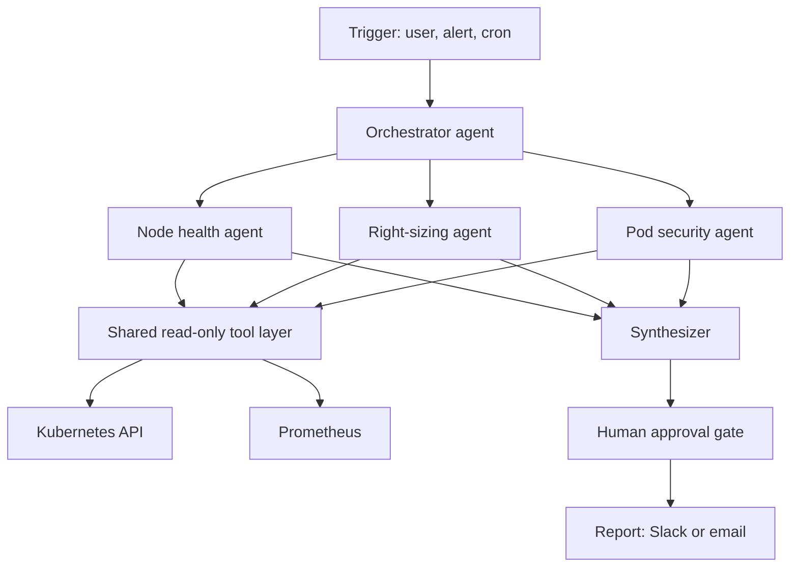
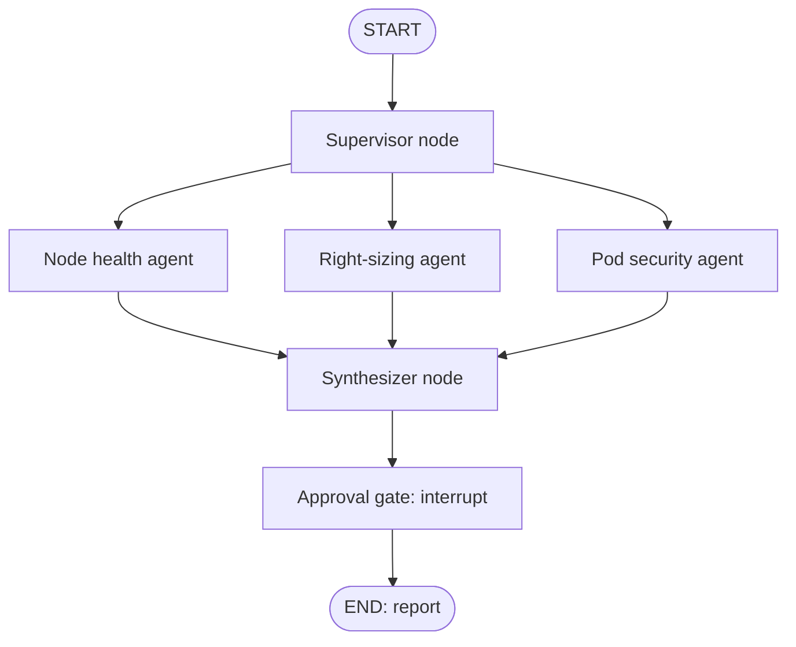
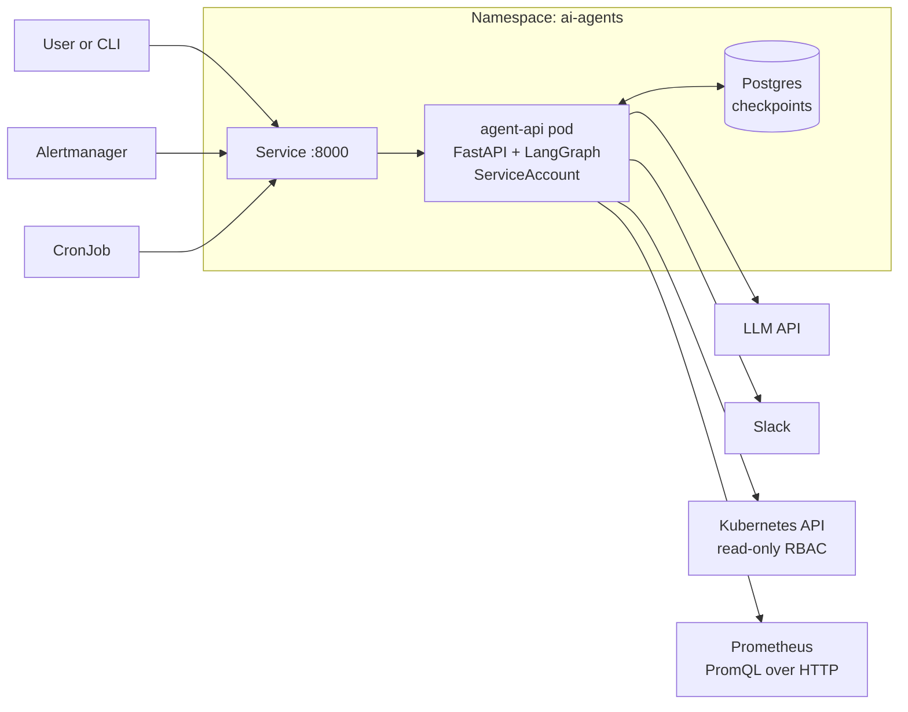
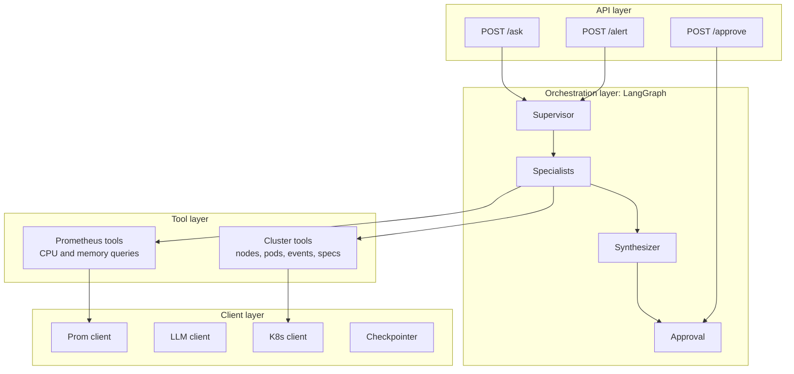

# Kubernetes Multi-Agent Troubleshooter

A multi-agent system that investigates a Kubernetes cluster using read-only tools. An orchestrator routes each request to specialist agents, merges their findings into one report, and waits for human approval before anything is acted on.

---

## 1. Project idea

Instead of one large agent with every tool, a supervisor hands work to three focused specialists. Each specialist has a short prompt and a small set of read-only tools, which keeps it accurate. A synthesizer combines the results, and a human approves any suggested fix.

### How it works

- **Orchestrator:** Receives a request, such as "node-3 is NotReady" or "run the daily check", and decides which specialists to call. It can run them in parallel and merge their findings into one report.
- **Node health agent:** Checks node conditions (disk, memory, PID pressure), kubelet and system events, and pod density per node. It returns a likely cause.
- **Right-sizing agent:** Compares requests and limits with real usage from Prometheus. It reports over- and under-provisioned workloads with suggested values.
- **Pod security agent:** Scans pod specs for privileged containers, root users, hostPath mounts, missing `securityContext`, and `latest` tags. It maps findings to a baseline such as the Pod Security Standards.
- **Shared tool layer:** All three agents use the same read-only tools, so each agent is mostly its own system prompt plus a few extra tools. Only the right-sizing agent needs Prometheus.

---

## 2. High-level architecture



---

## 3. Example run

Request: "Check the cluster before tomorrow's release."

1. The request enters the graph and the supervisor picks the specialists. A full pre-release check uses all three. "node-3 is NotReady" might use only the node health agent.
2. The specialists run in parallel. Each one loops: think, call a tool, read the result, decide whether more data is needed, then stop with an answer.
3. The synthesizer collects the findings into one report ranked by severity, for example: 1 node near disk pressure, 4 workloads over-provisioned, 2 pods running privileged.
4. The graph pauses at the approval gate. A human reads the report and approves or rejects any suggested fix.
5. The final report goes to Slack or email.

---

## 4. LangGraph design

The architecture maps to a LangGraph `StateGraph`.

| Architecture piece | LangGraph concept |
|---|---|
| Whole system | A `StateGraph` compiled with a checkpointer |
| Shared context | A `State` TypedDict (request, findings, report) |
| Orchestrator | A supervisor node that returns `Send` objects for the chosen agents |
| Specialist agents | Each is a ReAct sub-agent (`create_react_agent`) wrapped in a node |
| Read-only tools | `@tool` functions per agent, run by the agent's `ToolNode` |
| Parallel run | The `Send` API (fan-out) |
| Merging results | A reducer on `findings` (`operator.add`) |
| Human approval | `interrupt()` in a node, resumed with `Command(resume=...)` |
| Pause and resume | A checkpointer (`MemorySaver` for testing, Postgres for real use) |



### Skeleton

```python
import operator
from typing import Annotated, TypedDict
from langgraph.graph import StateGraph, START, END
from langgraph.types import Send, interrupt
from langgraph.prebuilt import create_react_agent
from langgraph.checkpoint.memory import MemorySaver

class State(TypedDict):
    request: str
    targets: list[str]
    findings: Annotated[list[dict], operator.add]   # reducer for parallel writes
    report: str

agents = {
    "node_health":  create_react_agent(llm, node_tools,     prompt=NODE_PROMPT),
    "right_sizing": create_react_agent(llm, sizing_tools,   prompt=SIZING_PROMPT),
    "pod_security": create_react_agent(llm, security_tools, prompt=SECURITY_PROMPT),
}

def make_node(name):
    def run(state: State):
        out = agents[name].invoke({"messages": [("user", state["request"])]})
        return {"findings": [{"agent": name, "result": out["messages"][-1].content}]}
    return run

def supervisor(state: State):
    # ask the LLM (structured output) which agents are needed
    return {"targets": pick_agents(state["request"])}

def synthesize(state: State):
    return {"report": llm_merge(state["findings"])}

def approval(state: State):
    interrupt({"report": state["report"], "ask": "Approve suggested fixes?"})
    return {}

g = StateGraph(State)
g.add_node("supervisor", supervisor)
for name in agents:
    g.add_node(name, make_node(name))
g.add_node("synthesize", synthesize)
g.add_node("approval", approval)

g.add_edge(START, "supervisor")
g.add_conditional_edges(
    "supervisor",
    lambda s: [Send(t, s) for t in s["targets"]],   # parallel fan-out
    list(agents),
)
for name in agents:
    g.add_edge(name, "synthesize")                  # fan-in
g.add_edge("synthesize", "approval")
g.add_edge("approval", END)

app = g.compile(checkpointer=MemorySaver())
```

> LangGraph's API changes between versions. In newer releases `create_react_agent` has moved to LangChain's `create_agent`, so check the docs for your installed version.

---

## 5. Low-level architecture

### 5.1 Deployment view



### 5.2 Layers inside the pod

1. **API layer:** `/ask` and `/alert` start a new run. `/approve` resumes a run that is paused at the approval gate, using the same run ID.
2. **Orchestration layer:** The LangGraph graph: supervisor, specialists, synthesizer, approval. It is the only layer that talks to the LLM.
3. **Tool layer:** Plain Python functions that the specialists call. The cluster tools cover nodes, pods, events, and specs. The Prometheus tools run PromQL queries. All of them are read-only.
4. **Client layer:** Thin wrappers that handle connections and auth.
   - K8s client: uses the pod's ServiceAccount token.
   - Prometheus client: uses an in-cluster URL.
   - LLM client: uses an API key from a Secret.
   - Checkpointer: `PostgresSaver`, saves state after each step.



The LLM client and the checkpointer are used by every graph node, so they have no single arrow in the diagram.

---

## 6. Tools per agent

| Agent | Example read-only tools |
|---|---|
| Node health | `list_nodes`, `describe_node`, `node_events`, `pods_per_node` |
| Right-sizing | `get_requests_limits`, `query_cpu_usage`, `query_memory_usage` (PromQL) |
| Pod security | `list_pods`, `get_pod_spec`, `check_security_context`, `find_latest_tags` |

---

## 7. Kubernetes objects

- `Deployment` and `Service` for the agent pod
- `ServiceAccount`, `ClusterRole` (get, list, watch on nodes, pods, events, and `metrics.k8s.io`), and `ClusterRoleBinding`
- `Secret` for the LLM key and the Postgres password
- `ConfigMap` for the Prometheus URL, the Slack webhook, and the model name
- `StatefulSet` and `Service` for Postgres, or a managed database
- Optional: a `CronJob` that calls `/ask` for the daily check, and an Alertmanager receiver pointing at `/alert`
- A `NetworkPolicy` limiting egress to the Kubernetes API, Prometheus, Postgres, and the LLM and Slack endpoints

---

## 8. Design decisions

1. **Orchestration style:** Start with one Python service where the orchestrator calls the specialists as sub-agents. Split into separate Deployments later only if you need independent scaling.
2. **Permissions:** One ServiceAccount with a read-only ClusterRole. Safety comes from RBAC, not from prompts. The agents cannot change anything.
3. **Output:** Findings go to Slack or email as a report. Fixes are suggested only, and a human applies them.
4. **Triggers:** On demand via an HTTP endpoint, on a schedule via a CronJob, and on alerts via an Alertmanager webhook.
5. **Replicas:** One pod is enough to start. With more replicas, the Postgres checkpointer keeps runs consistent, so any pod can resume an approval.
6. **Checkpointer:** `MemorySaver` locally, Postgres once deployed.

---

## 9. Why this design

- **Focused agents:** Short prompts and few tools mean fewer mistakes than one agent with every tool.
- **Speed:** The specialists run in parallel.
- **Safety:** Read-only access plus a human approval step.
- **Observability:** Each node is a traceable step (for example in LangSmith).
- **Easy to extend:** A new capability, such as a certificate expiry checker, is one new node, one prompt, and one tool list.

## 10. Trade-offs

- More LLM calls mean higher cost than a single agent.
- The supervisor can pick the wrong agent, so test its routing.
- Findings from different agents can overlap or conflict, and the synthesizer has to reconcile them.

---

## 11. Next steps

1. Pick the LLM (Claude, OpenAI, or self-hosted) and confirm Prometheus is available in the cluster.
2. Build the tool functions with the `kubernetes` Python client and the Prometheus HTTP API.
3. Write the system prompts for the three specialists and the supervisor.
4. Assemble the LangGraph graph and test locally with `kind` or `minikube`.
5. Write the Dockerfile and Kubernetes manifests (Deployment, Service, RBAC, Secret, ConfigMap, Postgres).
6. Add the `/ask`, `/alert`, and `/approve` endpoints, then wire up Alertmanager and a CronJob.
7. Later ideas: certificate expiry watcher, RBAC reviewer, upgrade readiness checker.
